# ALPA 镜头板生成器

**ALPA Lens Board Generator** — 一个**离线运行的单文件网页工具**，参数化生成 ALPA 大画幅镜头板、锥形延长桶和方箱延长桶（猪嘴），实时 3D 预览，一键导出 STL / 3MF 直接打印。

```
下载 → 双击 → 改参数 → 导出
```

[](https://tianqiqwq.github.io/alpa-lens-board-generator/)
[](https://github.com/tianqiQWQ/alpa-lens-board-generator/releases/latest)
[](LICENSE)


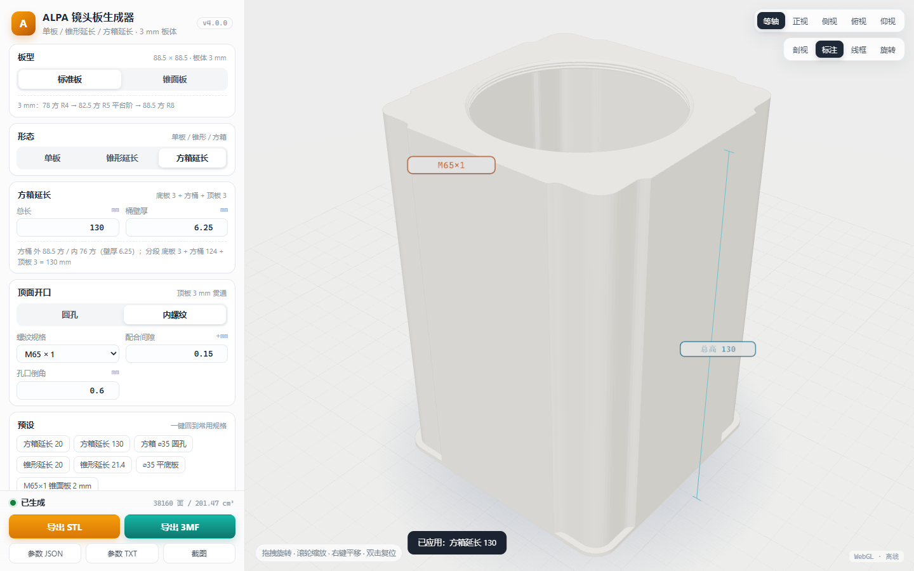

---

<details open>
<summary><b>目录</b></summary>

- [为什么做这个](#为什么做这个)
- [特性](#特性)
- [快速开始](#快速开始)
- [界面与效果](#界面与效果)
- [几何说明](#几何说明)
- [参数速查](#参数速查)
- [与参考件对齐](#与参考件对齐)
- [打印建议](#打印建议)
- [开发与验证](#开发与验证)
- [Roadmap](#roadmap)
- [License](#license)

</details>

---

## 为什么做这个

大画幅 DIY 里最劝退的一步是「接口尺寸」：镜头板的台阶高度、开口位置、螺纹规格、延长桶的壁厚，任何一项差 0.2 mm 就可能装不上或者漏光。

这个仓库把这几个接口从**参考件里量出来**，做成可调参数：

- 外形、台阶、开口位置全部来自实测，不是估的；
- 螺纹用 ISO 基本牙型 + 可调配合间隙，打印出来能拧；
- 所有零件都保证**水密网格**（可被切片软件正确识别），导出即打。

它不是一个 CAD 内核，而是一个「尺寸已经验证过的模板库 + 参数化变体生成器」。

---

## 特性

- **三种形态**，一个工具全包：

  | 形态 | 用途 | 可调 |
  |---|---|---|
  | 单板 | ALPA 镜头板（装 Copal / 自带快门的镜头） | 板型、凸台 0–5 mm、圆孔或 13 种内螺纹 |
  | 锥形延长 | 短延长 + 顶端螺纹（如 M42 小镜头） | 延长长度、外锥根部、顶端螺纹规格/深度 |
  | 方箱延长 | 长延长「猪嘴」（20–130 mm 级） | 总长、桶壁厚、顶面孔或螺纹 |

- **自适应几何**：凸台尖端 = 孔径 + 6；锥形延长的内锥自动做成**等壁厚**；方箱的底板开口固定、只有桶身随壁厚变化。
- **默认 20 mm 延长**：打开就是 20 mm 的短延长，需要长版直接改数字或点预设。
- **单文件离线**：three.js 已内联，断网可用，不上传任何数据，不需要 Node / Python。
- **实时 3D**：等轴 / 正视 / 侧视 / 俯视 / 仰视、剖视、标注、线框，鼠标拖拽旋转。
- **导出齐全**：STL（二进制）、3MF（Bambu Studio 直接拖入，已按热床中心摆放）、参数 JSON、参数 TXT、截图。
- **参数可分享**：所有参数写进 URL hash，复制链接即可复现同一个零件。
- **可验证**：自带 122 项几何单测 + 23 项成品静态验收 + 85 项 headless Chrome 端到端测试。

---

## 快速开始

**在线试用**（推荐先看一眼）：<https://tianqiqwq.github.io/alpa-lens-board-generator/>

离线使用（两种方式任选）：

- 从 [Releases](https://github.com/tianqiQWQ/alpa-lens-board-generator/releases/latest) 下载 `ALPA-lens-board-generator.html`（带样例包 / 截图包）；
- 或直接用仓库里的 [`ALPA镜头板生成器.html`](ALPA镜头板生成器.html)（约 730 KiB）；

然后：

1. 用 Chrome / Edge 双击打开（**不需要联网**）；
2. 左侧选形态、改参数，右侧实时预览；
3. 底部「导出 STL」或「导出 3MF」。

> 也可以直接打开仓库里的 [`index.html`](index.html)，内容完全相同，适合挂 GitHub Pages。

快捷键：`1–5` 切换视图，`S` 剖视，`D` 标注，`W` 线框，`A` 自动旋转，`R` 复位。

预设（面板左下角一键切换）：方箱延长 20 / 方箱延长 130 / 方箱 ⌀35 圆孔 / 锥形延长 20 / 锥形延长 21.4 / ⌀35 平底板 / M65×1 锥面板 2 mm。

---

## 界面与效果

### 三种形态：全景 + 截面

<table>
<tr>
<td width="50%">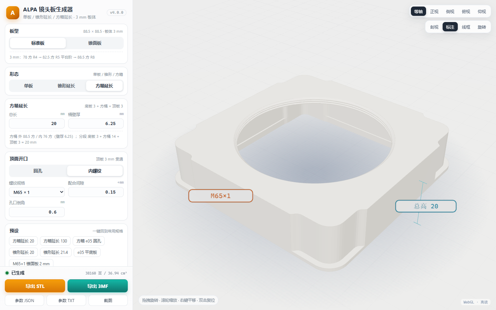<br><sub><b>方箱延长</b> · 全景：默认总长 20 mm（底板 3 + 方桶 14 + 顶板 3），顶面 M65×1</sub></td>
<td width="50%">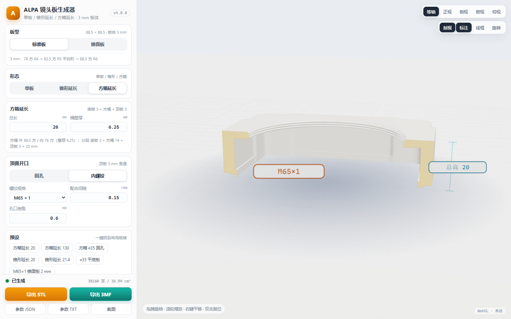<br><sub><b>方箱延长</b> · 截面：内壁光陷阱凹台、顶板贯通螺纹、底板开口</sub></td>
</tr>
<tr>
<td width="50%">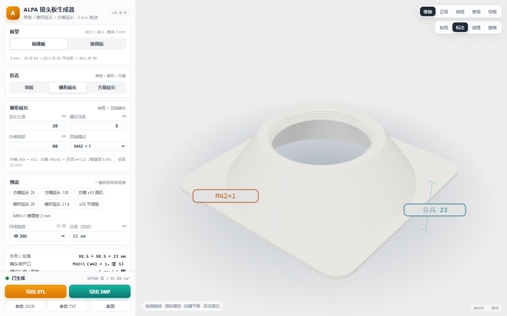<br><sub><b>锥形延长</b> · 全景：默认 20 mm 延长，外锥 ⌀80 → ⌀52</sub></td>
<td width="50%">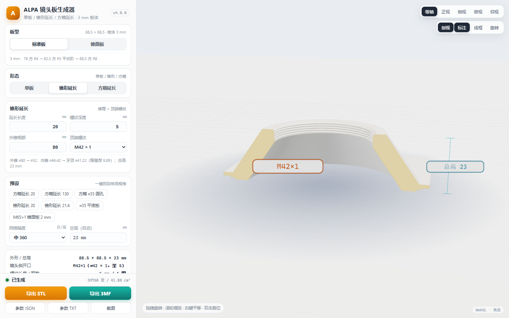<br><sub><b>锥形延长</b> · 截面：等壁厚内锥、顶端 M42×1 螺纹</sub></td>
</tr>
<tr>
<td width="50%">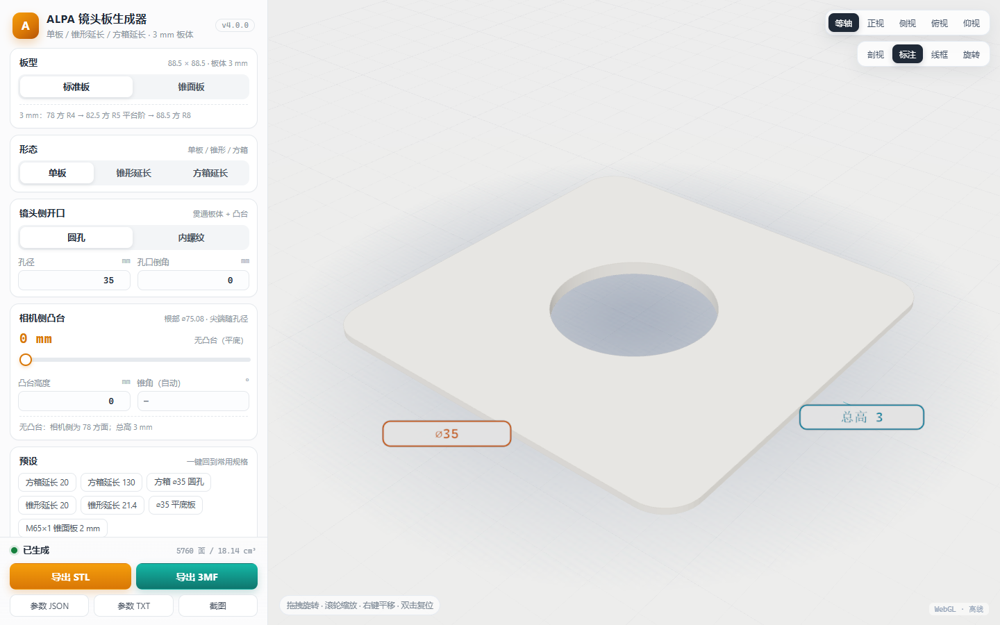<br><sub><b>单板</b> · 全景：⌀35 平底板（标准板 A，3 mm）</sub></td>
<td width="50%">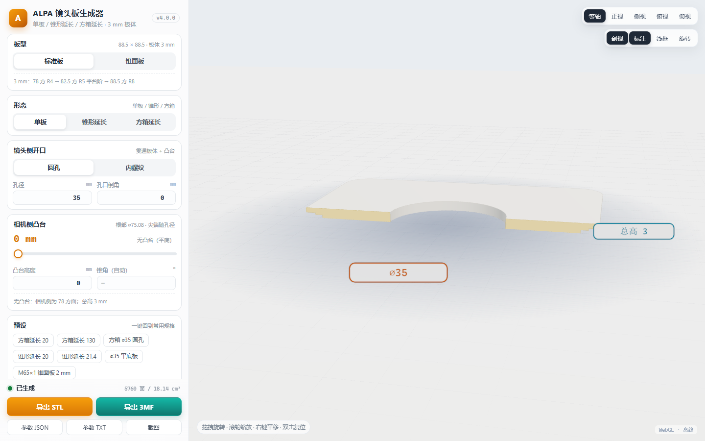<br><sub><b>单板</b> · 截面：3 mm 板体 + 贯通孔、孔口倒角</sub></td>
</tr>
</table>

### 长版参考件（方箱 130 mm）

<table>
<tr>
<td width="50%"><br><sub>等轴：底板 3 + 方桶 124 + 顶板 3，体积 201.47 cm³</sub></td>
<td width="50%">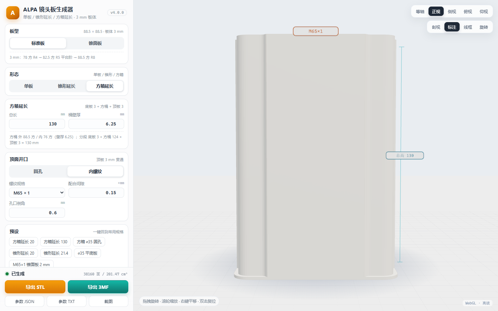<br><sub>正视：总高、锥度、螺纹规格实时标注</sub></td>
</tr>
<tr>
<td width="50%">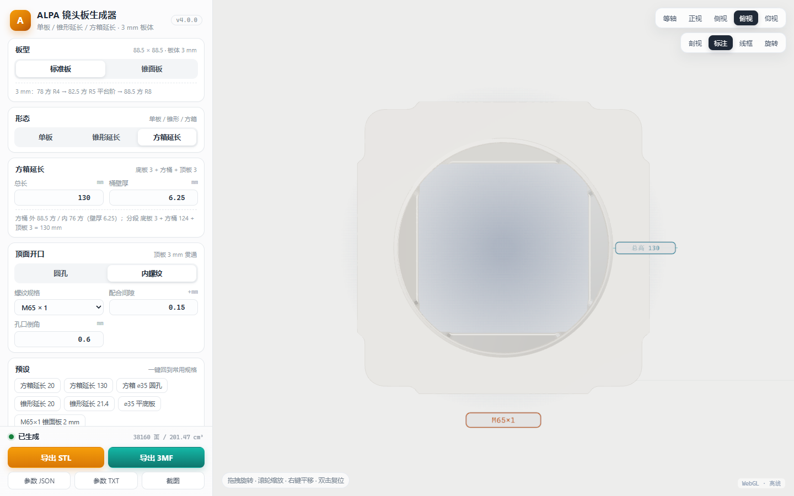<br><sub>俯视：88.5 阶梯切角轮廓 + 内腔光陷阱凹台</sub></td>
<td width="50%">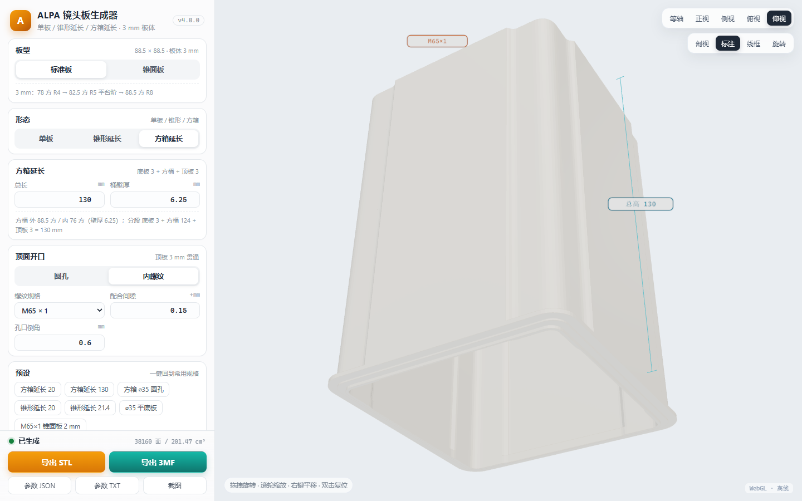<br><sub>仰视：ALPA 板层级底板（78 R4 / 82.5 R5 / 88.5 R8）</sub></td>
</tr>
</table>

### 其它

<table>
<tr>
<td width="50%">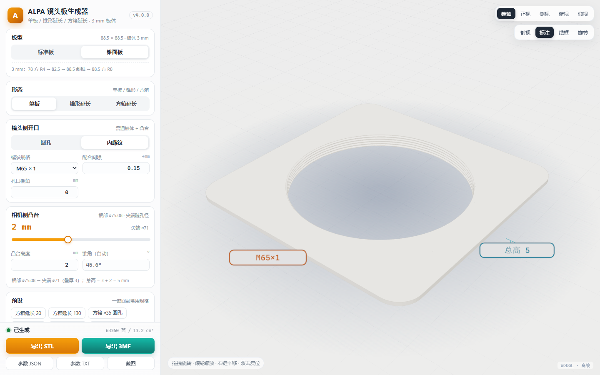<br><sub>板型 B（锥面板）+ M65×1 自适应凸台 2 mm</sub></td>
<td width="50%">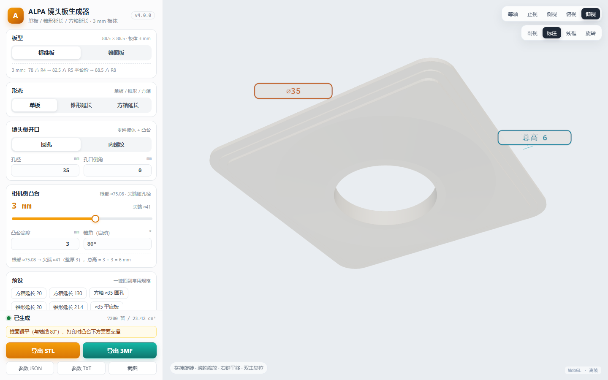<br><sub>⌀35 + 3 mm 凸台：尖端自动收到 ⌀41，锥角自动</sub></td>
</tr>
<tr>
<td width="50%">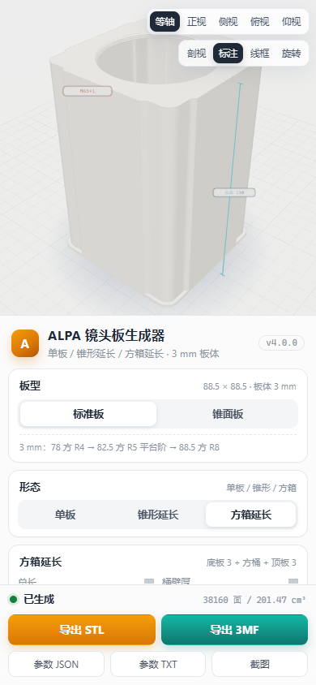<br><sub>响应式：手机上也能用</sub></td>
<td width="50%">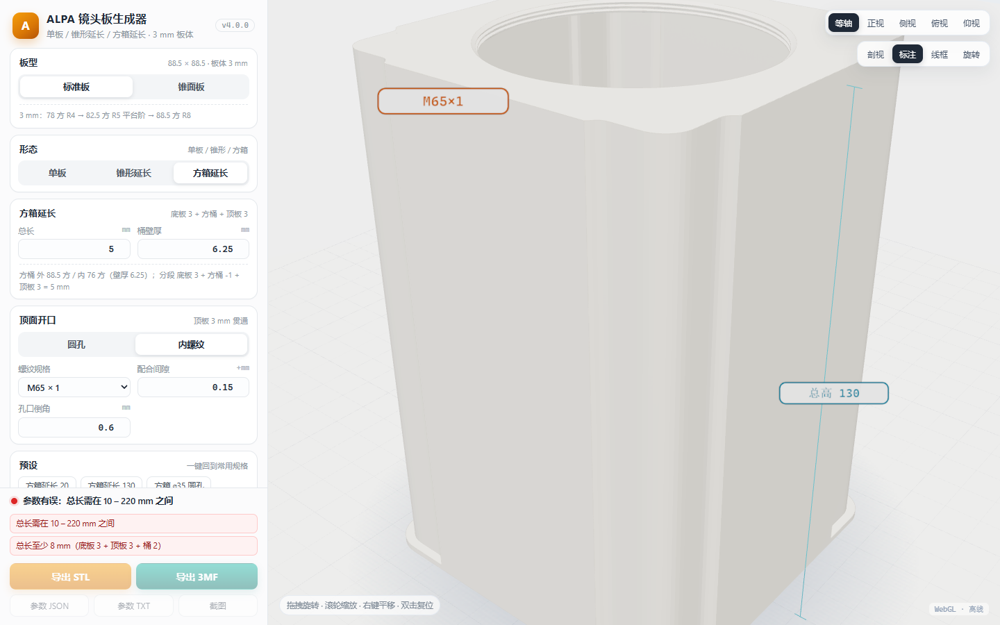<br><sub>尺寸越界红字提示并禁用导出</sub></td>
</tr>
</table>

---

## 几何说明

坐标系：`z = 0` 是相机侧贴合面，向镜头侧递增到 `z = H`；XY 关于原点对称，外形 88.5 × 88.5。

### 板体（三种形态共用，总厚 3.0 mm）

```
镜头侧  88.5 方 R8   1.4
        82.5 方 R5   0.6   ← 标准板：平台阶；锥面板：斜锥过渡
        78   方 R4   1.0
相机侧（z = 0）
```

### 单板

- **凸台 0–5 mm**：根部固定 ⌀75.08，尖端 = 孔/螺纹大径 + 6（单边壁厚 3），两端之间是一条直线锥，锥角自动。
  - M65 → 尖端 ⌀71；⌀35 圆孔 → 尖端 ⌀41；孔太大时尖端收到根部变直筒。
- **镜头侧开口**：圆孔 ⌀D 或内螺纹，贯通板体 + 凸台。
- 内螺纹 ISO 基本牙型（大径 D、牙距 P、小径 D1 = D − 1.08253P、牙顶平 P/8、牙根平 P/4、牙侧 30°），**配合间隙**把牙顶牙根一起外移（默认 +0.15，打印放宽）。

### 锥形延长

```
外锥   根部 ⌀D0（60–86.5，默认 80）→ 尖端 ⌀(螺纹大径 + 10)
内锥   根部 ⌀(自适应) → 螺纹牙顶 ⌀      ← 与外侧等壁厚
顶端   内螺纹（默认 M42×1），深度可调
```

等壁厚公式（外锥、内锥斜率相同，壁厚处处相等）：

```
内锥根部半径 = 牙顶半径 − 外锥斜率 × (板厚 + 延长长度 − 螺纹深度)
```

默认参数（M42×1 / 根 ⌀80 / L 20）→ 内锥 ⌀66.4 → ⌀41.2，壁厚恒 8.89、总高 23。

### 方箱延长（按参考件 3MF 切面实测）

```
z=0    ┌ 底板 3 mm：ALPA 板层级 78 R4 / 82.5 R5 / 88.5 R8，开口固定 76（+0.5 凹台）
       │
       │ 方桶 总长−6 mm：外 88.5 阶梯切角 / 内 (88.5 − 2×壁厚) 方 R3
       │                内壁四面光陷阱凹台：深 1.25 / 宽 46.7 / 45° 倒角收口
       │
z=H    └ 顶板 3 mm：中心开孔（圆孔或内螺纹，贯通），顶面孔上限 ⌀82.5
```

- **调壁厚只影响桶身内腔**，底板外形与开口不变；
- 总长 = 底板 3 + 方桶 + 顶板 3，**默认 20**（参考件为 130）。

---

## 参数速查

| 参数 | 范围 / 默认 | 说明 |
|---|---|---|
| 板型 | 标准板 / 锥面板 | 只影响 82.5 那 0.6 mm 段是台阶还是斜锥 |
| 单板 · 凸台高度 | 0 – 5 mm，默认 2 | 0 = 平底 78 方面 |
| 单板 · 开口 | 圆孔 ⌀D / 内螺纹 | 13 种内置规格 + 自定义大径牙距 |
| 锥形 · 延长长度 | 5 – 60 mm，**默认 20** | 板体 88.5 面 → 顶端 |
| 锥形 · 外锥根部 | 60 – 86.5，默认 80 | 在 88.5 面上 |
| 锥形 · 螺纹深度 | 1.5 – 长度−2，默认 5 | 顶端螺纹有效长度 |
| 方箱 · 总长 | 10 – 220 mm，**默认 20** | 含底板与顶板 |
| 方箱 · 桶壁厚 | 2 – 20 mm，默认 6.25 | 内腔 = 88.5 − 2×壁厚 |
| 方箱 · 顶面开口 | 圆孔 / 内螺纹 | 贯通顶板 3 mm，上限 ⌀82.5 |
| 配合间隙 | 0 – 0.8 mm，默认 0.15 | 螺纹打印放宽量 |
| 孔口倒角 | 0 – 3 mm，默认 0.6 | 螺纹入口/孔口 |
| 网格精度 | 120 – 1440 段/圈，默认 360 | 螺纹建议 ≥ 360 |

---

## 与参考件对齐

| 项目 | 参考件 | 本工具 | 偏差 |
|---|---|---|---|
| 方箱体积（130 mm） | 201,949.9 mm³（3MF 网格积分） | 201,468 mm³ | **−0.24 %** |
| 方箱总长/外形/内腔 | 130 / 88.5 / 76 | 同 | — |
| 方箱顶面 | M65×1，贯通 3 mm | 同 | — |
| 单板 ⌀35（去沉台） | 18,143.04 mm³（STEP 解析） | 18,141.4 mm³ | **−0.009 %** |
| 锥面板 M65 凸台 2 | 13,195.75 mm³（3MF） | 13,200.8 mm³ | **+0.04 %** |
| 锥形延长 M42·L21.4 | 总高 24.4、外锥 ⌀80→⌀52、M42×1 深 4.86 | 同（内锥按等壁厚重做） | 见下 |

> 锥形延长的**内锥**是按需求做的「等壁厚」版本（参考件是 2→8.7 的喇叭壁），所以体积从 34.8 cm³ 变成 43.3 cm³；外形、总高、外锥、螺纹与参考件一致。

---

## 打印建议

- **摆放**：一律相机侧（板面）朝下贴热床，桶身/锥筒朝上，螺纹朝上，无需支撑。
- **方箱**：0.2 mm 层高、3–4 墙；短版（20 mm）可直接打，长版（130 mm）建议开 brim。
- **螺纹**：0.16–0.2 mm 层高、3 墙；配合间隙先试 **+0.15**，拧不动调到 +0.25。
- **材料**：PLA / PETG；PETG 螺纹更耐反复拧。
- **3MF**：已按热床中心 (128,128,0) 摆放，直接拖进 Bambu Studio。

---

## 开发与验证

### 仓库结构

```
src/index.html          界面骨架（<!--INLINE_VENDOR--> / <!--INLINE_APP--> 占位）
src/app/00-core.js      参数 schema / 派生 / 自适应规则 / 校验 / URL hash
src/app/10-geometry.js  几何核：环-层扫掠 + 阶梯切角轮廓 + 螺纹牙型 + 剖面封盖
src/app/20-export.js    STL / 3MF / 参数 JSON / TXT
src/app/30-scene.js     three.js 场景、剖视、仰视、标注
src/app/40-ui.js        参数面板、形态切换、重建、导出、提示
src/app/50-main.js      启动、window.__ALPA__ API
vendor/                 three r147 + OrbitControls（内联进单文件）
tools/build.mjs         打包成单文件
tools/test-geometry.mjs 几何单测（Node，无浏览器）
tools/e2e.mjs           headless Chrome 端到端（CDP，零第三方依赖）
tools/verify-built.mjs  成品静态验收
tools/make-samples.mjs  按预设生成 samples/
tools/ref/              从 STEP/3MF 参考件提取基准 → reference.json
samples/                7 组预设的 STL / 3MF / 参数 TXT
preview/                14 张截图（由 e2e 自动生成）
```

### 构建与测试

```powershell
$NODE = '<node.exe>'   # 任一 Node 18+
& $NODE tools/build.mjs --mirror index.html   # 打包成单文件
& $NODE tools/verify-built.mjs                # 成品静态验收
& $NODE tools/test-geometry.mjs               # 几何单测
& $NODE tools/e2e.mjs                         # headless Chrome 端到端
& $NODE tools/make-samples.mjs                # 重新生成 samples/
```

当前验收状态（本机实测）：

```
test-geometry.mjs   122 / 122 通过   水密、体积、轮廓、牙距、导出回读、参数校验
verify-built.mjs     23 /  23 通过   单文件、无外链、无 fetch、语法、体积
e2e.mjs              85 /  85 通过   启动、三形态几何、三种形态截图、导出/下载、
                                     剖视、视图、预设、滑杆数字联动、移动端、零报错
```

单次几何重建 ≈ 20–50 ms，单文件 ≈ 730 KiB。

### 给开发者的 API

页面暴露 `window.__ALPA__`，方便脚本化验证或做二次封装：

```js
__ALPA__.setParams({ mode: 'box', boxLen: 130, boxWall: 6.25 });
__ALPA__.exportBytes('3mf');   // 返回 ArrayBuffer
__ALPA__.getAudit();           // { triangles, volume, watertight, bboxMin/Max }
__ALPA__.screenshot();         // 下载 PNG
```

参数也可以直接写在 URL 里复现，例如：

```
ALPA镜头板生成器.html#m=box&bl=130&bw=6.25&h=thread&t=M65x1&g=0.15
```

---

## Roadmap

- [x] 单板：标准板 / 锥面板、自适应凸台、13 种内螺纹
- [x] 锥形延长：等壁厚自适应、外锥根部可调
- [x] 方箱延长：按 3MF 实测复刻（底板 / 桶身 / 顶板 / 光陷阱）
- [ ] 方箱内部 8 条偏轴盲孔（需要通用二维布尔挤出引擎）
- [ ] 两件式延长桶（可换螺纹前板 + 4×⌀12 / 8×⌀6 螺钉孔）
- [ ] 相机侧卡口槽、沉台 / Copal 沉孔
- [ ] 真 B-rep STEP 输出（build123d，复用同一套参数 JSON）供 CNC

---

## License

[MIT](LICENSE)

几何尺寸来自作者自己的实测参考件；内置的 [three.js](https://threejs.org/) 按 MIT 许可分发。
